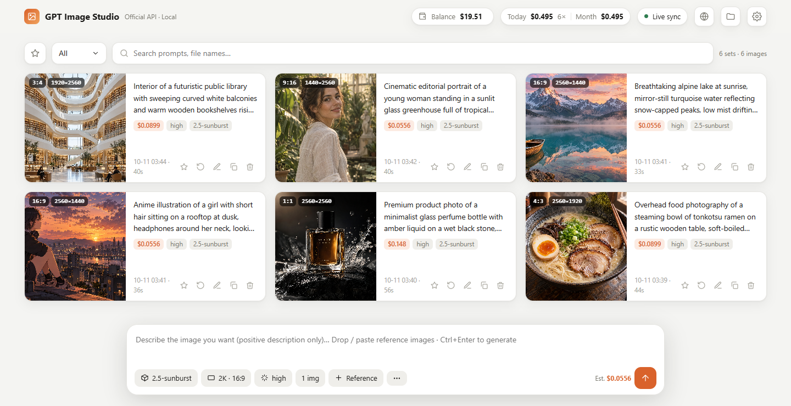
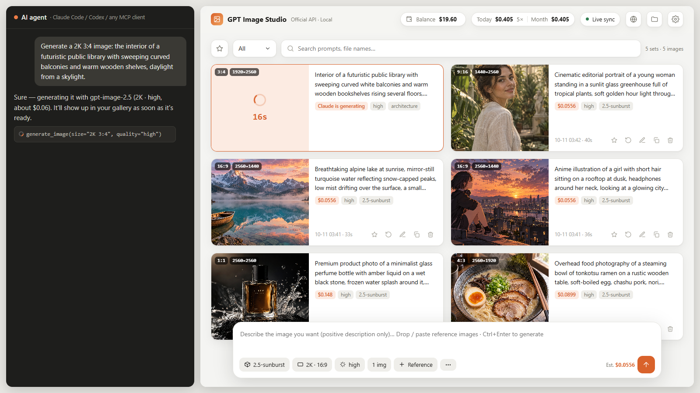

# GPT Image 스튜디오

[English](README.md) · [中文](README.zh-CN.md) · [日本語](README.ja.md) · **한국어** · [Русский](README.ru.md)

**본인의 OpenAI API 키로 `gpt-image-2.5`를 사용하는 이미지 생성 작업대입니다. AI 에이전트에게 한마디만 하면 이미지가 만들어지고, 로컬 웹 갤러리에서 이미지와 장당 비용, 남은 잔액을 실시간으로 확인할 수 있습니다.**



*에이전트에게 말하면 바로 나타납니다:*



## 주요 기능

- **AI 에이전트에서 바로 생성**: Claude Code, Codex 등 명령을 실행할 수 있는 에이전트에게 "2K 16:9로 ○○ 이미지 만들어 줘"라고 하면, 공식 API를 호출해 로컬에 저장하고 비용도 알려 줍니다.
- **웹 갤러리 실시간 동기화**: 에이전트가 생성하는 동안 페이지에 "생성 중" 카드와 타이머가 나타나고, 완료되면 결과로 바뀝니다. 페이지에서 직접 생성할 수도 있습니다.
- **모든 매개변수 지원**: gpt-image-2.5 sunburst / flare, 1K / 2K / 4K 임의 화면 비율(최대 3840×2160), 품질 low부터 **xhigh / max**까지, 참고 이미지 최대 16장, 마스크 부분 재생성.
- **비용 관리**: 장당 비용을 OpenAI가 돌려준 실제 토큰 사용량으로 계산하고, 오늘·이번 달·누적 지출을 집계합니다. 잔액을 한 번 보정하면 남은 금액을 자동으로 추적합니다(OpenAI에는 잔액 API가 없어서, 이것이 가장 정확한 방법입니다).
- **갤러리 기능**: 즐겨찾기, 상태별 필터(완료 / 생성 중 / 실패), 검색, 설정 원클릭 재사용, 결과를 참고 이미지로 삼아 계속 편집. 삭제한 이미지는 `.trash` 폴더로 옮겨지며 완전히 지워지지 않습니다.
- **어디서나 사용**: 같은 페이지를 GitHub Pages에 올릴 수 있습니다. 로컬 서비스가 실행 중인 컴퓨터에서 열면 자동으로 연결되고, 다른 기기에서는 "브라우저 모드"로 동작합니다(키와 이미지는 그 브라우저에만 저장).
- **5개 언어**: English, 中文, 日本語, 한국어, Русский. 브라우저 언어를 따라가며 페이지에서 바꿀 수도 있습니다.
- **중계 서비스 지원**: one-api, new-api 등 OpenAI 호환 중계 서비스를 지원하며, 이미지 URL 응답, 장당 과금, 중계 서비스 실제 잔액 조회도 됩니다(아래 「중계 서비스」 참고).
- **의존성 없음**: Python 3.9 이상만 있으면 됩니다. `pip install`이 필요 없습니다.

## 설치

### Claude Code 스킬로 설치 (추천)

```bash
git clone https://github.com/konglingbukong/gpt-image-studio ~/.claude/skills/gpt-image
```

1. `start.bat`(Windows) 또는 `sh start.sh`(macOS / Linux)를 실행하면 브라우저에서 `http://127.0.0.1:8765`가 열립니다.
2. 설정 → API에서 OpenAI API 키를 입력하고 "연결 테스트"(무료)를 누릅니다.
3. Claude Code에게 이미지를 만들어 달라고 하면 됩니다.

키는 환경 변수 `OPENAI_API_KEY`나 `config.json`으로도 지정할 수 있습니다(`config.example.json` 참고, `config.json`은 git에 포함되지 않습니다).

### 웹 페이지만 사용 (설치 불필요)

**https://konglingbukong.github.io/gpt-image-studio/** 를 열고 설정에서 키를 입력하면 바로 생성할 수 있습니다. 이때는 브라우저 모드로 동작합니다. 키와 이미지는 브라우저에만 저장되고, 브라우저가 OpenAI와 직접 통신하므로 제3자 서버를 거치지 않습니다.

### 다른 에이전트 (Codex, Cursor, Gemini, Antigravity, WorkBuddy 등)

에이전트가 지원하는 방법을 하나 고르세요.

**① MCP (대부분의 에이전트가 지원)**: `scripts/mcp_server.py`를 MCP 서버로 등록하면 `generate_image`, `check_connection`, `get_spending` 세 가지 도구가 생깁니다. `<path>`는 클론한 폴더로 바꾸세요.

- **Claude Code**: `claude mcp add gpt-image -- python <path>/scripts/mcp_server.py`
- **Codex** (`~/.codex/config.toml`):
  ```toml
  [mcp_servers.gpt-image]
  command = "python"
  args = ["<path>/scripts/mcp_server.py"]
  ```
- **Cursor / Gemini CLI / JSON으로 설정하는 기타 클라이언트** (`mcpServers`):
  ```json
  { "mcpServers": { "gpt-image": { "command": "python", "args": ["<path>/scripts/mcp_server.py"] } } }
  ```

**② 스킬 폴더**: `SKILL.md` 형식을 지원하는 에이전트(Codex, WorkBuddy 등)는 이 폴더를 스킬 디렉터리에 넣기만 하면 됩니다.

**③ 안내 파일**: 명령을 실행할 수 있는 다른 에이전트에게는 [AGENTS.md](AGENTS.md)를 읽게 하세요.

어떤 방법을 쓰든 이미지는 같은 폴더에 저장되고 웹 작업대에 실시간으로 표시됩니다.

**검증 완료**: Claude Code, Codex(ChatGPT 데스크톱 앱 포함), WorkBuddy, Antigravity, DeepSeek Harness(dsh). 전체 목록, 에이전트별 설정 방법, 인터페이스 규격, 새 에이전트 추가 절차는 **[docs/INTEGRATIONS.md](docs/INTEGRATIONS.md)** 에 있습니다. 사용하시는 에이전트가 아직 지원되지 않는다면 Issues에 "연동 요청"을 올리거나, [CONTRIBUTING.md](CONTRIBUTING.md)를 참고해 직접 연결한 뒤 PR을 보내 주세요.

## 중계 서비스 (OpenAI 호환 프록시)

OpenAI에 직접 연결하지 않고 중계 서비스(one-api, new-api 등)를 통해 gpt-image를 쓰는 사람도 많습니다. 이런 서비스도 지원합니다.

- **설정**: 설정 → API에서 API URL에 중계 서비스 주소(보통 `/v1`로 끝남)를, API Key에 그 키를 입력합니다. 모델 이름이 다르면(예: `gpt-image-2.5`) 모델 메뉴에 직접 입력하세요.
- **이미지 URL**: base64 데이터 대신 이미지 링크를 돌려주는 중계 서비스도 지원합니다. 이미지를 자동으로 내려받아 저장합니다.
- **엄격한 중계 서비스**: 공식 API 전용 매개변수(`moderation`, `output_format`, `background`)를 거부한다면 「**기본 매개변수만 전송**」을 켜세요. 이런 오류가 나면 메시지에서도 이 설정을 안내합니다.
- **장당 과금**: 대부분의 중계 서비스는 장당 과금입니다. 「요금 → 장당 가격」을 입력하면 토큰 대신 장 수로 비용을 계산합니다.
- **실제 잔액**: one-api / new-api 형식 청구 엔드포인트를 지원하면 중계 서비스의 실제 잔액을 자동으로 읽습니다. 보정이 필요 없습니다.
- **연결 테스트**: `GET /models`만 구현한 중계 서비스에서도 동작합니다.

명령줄에서는 `config.json`의 `"api_url"`, `"api_key"`, `"model"`, `"minimal_params": true`, `"rates": {"per_image": 0.04}`, `"balance_source": "auto" | "relay" | "manual"`로 설정합니다.

## 명령줄

```bash
python scripts/gen.py --prompt-file prompt.txt --size "2K 16:9" --quality high --name cover
python scripts/gen.py --prompt "an orange cat" --size 1024x1024 --quality low
python scripts/gen.py --prompt-file p.txt --ref face.png --ref outfit.png --size "4K 9:16"
python scripts/gen.py --check          # 키와 네트워크 테스트 (무료)
python scripts/gen.py ... --json       # JSON 한 줄 출력 (스크립트·연동용)
```

모든 매개변수는 [SKILL.md](SKILL.md)에 정리되어 있습니다. 명령줄 메시지는 기본이 영어입니다(`config.json`에 `"lang": "zh"`를 쓰면 중국어).

## 개인 설정

스킬 폴더에 `rules.local.md`를 만들고 기본 사양, 프롬프트 작성 습관 등 본인의 선호를 적어 두면, 에이전트가 생성 전에 이 파일을 읽습니다. 이 파일은 git에 포함되지 않습니다.

## 보안

- 로컬 서비스는 `127.0.0.1`에서만 동작하며 `Host`와 `Origin`을 모두 확인합니다. 로컬 페이지와 `config.json`의 `allowed_origins`에 적힌 사이트에서 온 요청만 받으므로, 다른 웹 페이지가 이를 악용해 돈을 쓰게 할 수 없습니다.
- 키는 설정한 API URL(기본값은 OpenAI 공식)로만 전송됩니다.

## 요금 안내

비용은 `config.json`의 `rates`(USD / 100만 토큰)로 계산합니다. 기본값은 작성 시점의 gpt-image-2.5 가격입니다(텍스트 입력 5, 이미지 입력 8, 이미지 출력 30). **OpenAI가 가격을 바꾸면 설정 → 요금에서 수정하세요.** 표시되는 잔액은 추정치이며, 정확한 금액은 OpenAI 대시보드에서 확인하세요.

## 감사의 말

UI 레이아웃은 [CookSleep/gpt_image_playground](https://github.com/CookSleep/gpt_image_playground)(MIT)를 참고했습니다. 코드는 독자적으로 작성했습니다.

## 라이선스

[MIT](LICENSE)
