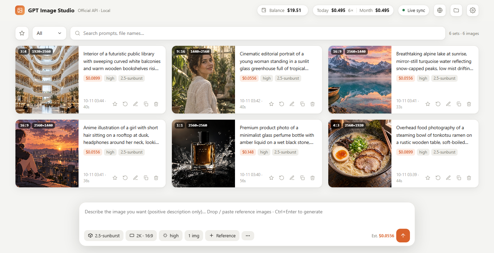
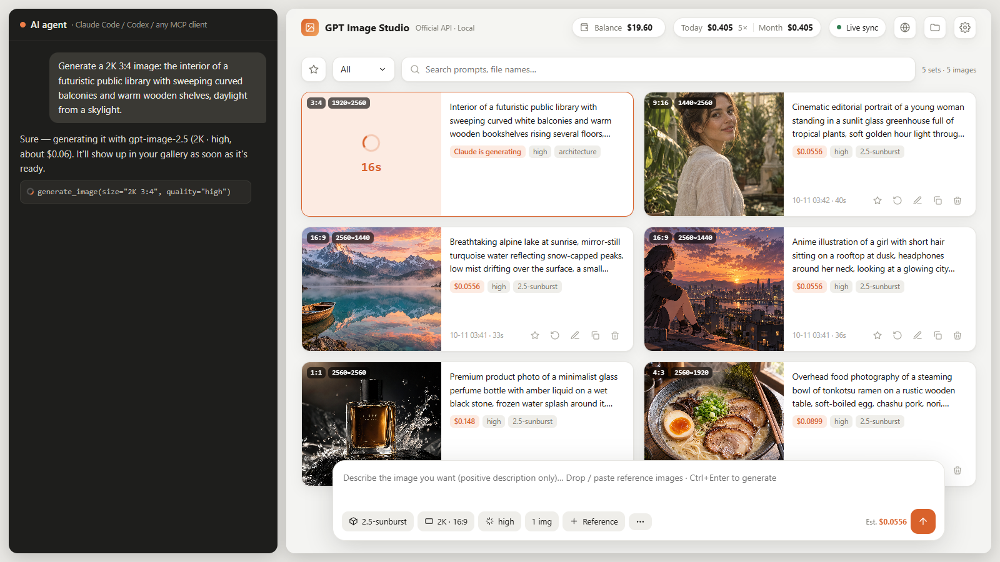

# GPT Image Studio

[English](README.md) · [中文](README.zh-CN.md) · [日本語](README.ja.md) · [한국어](README.ko.md) · **Русский**

**Рабочее место для генерации изображений в `gpt-image-2.5` от OpenAI с вашим собственным API-ключом. Попросите ИИ-агента одной фразой, и изображение появится в локальной веб-галерее вместе с его стоимостью и остатком баланса.**



*Попросите агента — и смотрите, как появляется результат:*



## Возможности

- **Генерация прямо из ИИ-агента.** Попросите Claude Code, Codex или другого агента, умеющего запускать команды, сделать «изображение 2K 16:9 с …». Агент вызовет официальный API, сохранит файл локально и скажет, сколько стоило изображение.
- **Веб-галерея в реальном времени.** Пока агент генерирует, на странице появляется карточка «генерируется» с таймером, а затем результат. Генерировать можно и прямо со страницы.
- **Все параметры.** gpt-image-2.5 sunburst / flare; 1K / 2K / 4K с любым соотношением сторон (до 3840×2160); качество от `low` до **`xhigh` / `max`**; до 16 референсов; перерисовка по маске.
- **Учёт расходов.** Студия рассчитывает стоимость изображений по числу токенов и показывает расходы за день, месяц и всё время. Последующие расходы вычитаются из баланса, полученного при синхронизации или введённого вручную.
- **Инструменты галереи.** Избранное, фильтр по статусу (готово / генерируется / ошибка), поиск, повтор настроек в один клик, «сделать референсом», чтобы продолжить работу над результатом. Удалённое попадает в папку `.trash`, а не стирается.
- **Работает где угодно.** Ту же страницу можно разместить на GitHub Pages. На компьютере с локальным сервисом она подключается к нему автоматически, а на других устройствах работает в *режиме браузера*: ключ и изображения остаются в этом браузере.
- **Попросите ИИ «Синхронизируй баланс».** Подключите MCP и войдите в OpenAI в браузере, доступном агенту. Агент прочитает остаток средств API на странице оплаты, проверит организацию и сохранит сумму в локальной студии. Для периодического обновления доступно [расширение браузера](extension/README.md).
- **5 языков.** English, 中文, 日本語, 한국어 и Русский. Язык берётся из настроек браузера и переключается на странице.
- **Поддержка посредников.** Работает с OpenAI-совместимыми посредниками (one-api, new-api …), включая ответы со ссылками на изображения, оплату за изображение и чтение реального баланса (см. раздел «Сервисы-посредники» ниже).
- **Без зависимостей.** Нужен только Python 3.9 или новее, ничего не нужно ставить через `pip install`.

### Одежда и позы в v0.5.0

При первом запуске локальной студии загрузка начнётся, когда кнопки выбора будут видны 20 секунд. В двух библиотеках 1 407 нарядов и 288 поз (1 439 изображений с разных ракурсов). Объём загрузки около 820 МБ, для установки рекомендуется 1,7 ГБ свободного места. Студия запоминает выбор «Не скачивать». Позже загрузку можно начать из окна «Одежда и позы» или остановить в процессе. Материалы поз предназначены только для некоммерческого использования. [Расположение файлов, настройки и источники](README.md#local-outfit-and-pose-libraries)

## Установка

### Как навык Claude Code (рекомендуется)

```bash
git clone https://github.com/konglingbukong/gpt-image-studio ~/.claude/skills/gpt-image
```

1. Запустите `start.bat` (Windows) или `sh start.sh` (macOS / Linux). В браузере откроется `http://127.0.0.1:8765`.
2. В разделе Настройки → API введите свой API-ключ OpenAI и нажмите «Проверить подключение» (бесплатно).
3. Попросите Claude Code сгенерировать изображение.

Ключ можно также задать через переменную окружения `OPENAI_API_KEY` или в `config.json` (см. `config.example.json`; `config.json` не попадает в git).

### Только веб-страница (ничего не устанавливать)

Откройте **https://konglingbukong.github.io/gpt-image-studio/** и введите ключ в настройках. Страница работает в режиме браузера: ключ и изображения хранятся только в вашем браузере, и он обращается к OpenAI напрямую, без сторонних серверов.

### Другие агенты (Codex, Cursor, Gemini, Antigravity, WorkBuddy …)

Выберите способ, который поддерживает ваш агент:

**① MCP.** Зарегистрируйте `scripts/mcp_server.py`, чтобы агенту стали доступны `generate_image`, `check_connection`, `get_spending` и `sync_balance`. После обновления переподключите MCP-сервер. Замените `<path>` на папку с репозиторием.

- **Claude Code:** `claude mcp add gpt-image -- python <path>/scripts/mcp_server.py`
- **Codex** (`~/.codex/config.toml`):
  ```toml
  [mcp_servers.gpt-image]
  command = "python"
  args = ["<path>/scripts/mcp_server.py"]
  ```
- **Cursor / Gemini CLI / другие клиенты с настройкой в JSON** (`mcpServers`):
  ```json
  { "mcpServers": { "gpt-image": { "command": "python", "args": ["<path>/scripts/mcp_server.py"] } } }
  ```

**② Папка навыка.** Агенты с поддержкой формата `SKILL.md` (Codex, WorkBuddy …) могут использовать эту папку как навык: просто положите её в их каталог навыков.

**③ Файл инструкций.** Любой другой агент, который умеет запускать команды, может действовать по [AGENTS.md](AGENTS.md).

Каким бы путём вы ни пошли, изображения сохраняются в одну и ту же папку и сразу появляются в веб-интерфейсе.

**Проверено:** Claude Code, Codex (включая настольное приложение ChatGPT), WorkBuddy, Antigravity и DeepSeek Harness (dsh). Полный список, настройка для каждого агента, описание интерфейсов и шаги для подключения нового агента — в **[docs/INTEGRATIONS.md](docs/INTEGRATIONS.md)**. Если вашего агента ещё нет в списке, создайте issue «Integration request» или подключите его сами по [CONTRIBUTING.md](CONTRIBUTING.md) и отправьте PR.

## Сервисы-посредники (OpenAI-совместимые прокси)

Многие работают с gpt-image не напрямую через OpenAI, а через сервисы-посредники (one-api, new-api и подобные). Они тоже поддерживаются:

- **Настройка:** в Настройки → API укажите адрес посредника в API URL (обычно заканчивается на `/v1`) и его ключ в API Key. Если модель там называется иначе (например, `gpt-image-2.5`), введите это имя в меню моделей.
- **Ссылки на изображения:** если посредник возвращает ссылку вместо данных base64, изображение автоматически скачивается и сохраняется.
- **Строгие посредники:** если посредник отклоняет параметры, которые есть только в официальном API (`moderation`, `output_format`, `background`), включите **«Отправлять только базовые параметры»**. Сообщение об ошибке само подскажет это.
- **Оплата за изображение:** большинство посредников берут плату за изображение. Укажите **Цены → Цена за изображение**, и стоимость будет считаться по числу изображений, а не по токенам.
- **Реальный баланс:** если посредник поддерживает биллинговые эндпоинты в стиле one-api / new-api, реальный остаток читается автоматически, без ручной настройки.
- **Проверка подключения:** работает и с посредниками, у которых есть только `GET /models`.

Для командной строки — поля `config.json`: `"api_url"`, `"api_key"`, `"model"`, `"minimal_params": true`, `"rates": {"per_image": 0.04}`, `"balance_source": "auto" | "relay" | "manual"`.

## Командная строка

```bash
python scripts/gen.py --prompt-file prompt.txt --size "2K 16:9" --quality high --name cover
python scripts/gen.py --prompt "an orange cat" --size 1024x1024 --quality low
python scripts/gen.py --prompt-file p.txt --ref face.png --ref outfit.png --size "4K 9:16"
python scripts/gen.py --check          # проверить ключ и сеть, бесплатно
python scripts/gen.py ... --json       # одна строка JSON для скриптов и интеграций
```

Все параметры описаны в [SKILL.md](SKILL.md). Сообщения командной строки по умолчанию на английском (`"lang": "zh"` в `config.json` — на китайском).

## Личные настройки

Создайте в папке навыка файл `rules.local.md` и опишите свои предпочтения, например размеры по умолчанию и привычки в промптах. Агенты читают его перед генерацией. Этот файл не попадает в git.

## Безопасность

- Локальный сервис слушает только `127.0.0.1` и проверяет `Host` и `Origin`. Он принимает запросы только от локальной страницы и от сайтов из `allowed_origins` в `config.json`, поэтому другие веб-страницы не смогут тратить через него ваши деньги.
- Ключ отправляется только на указанный вами API URL (по умолчанию OpenAI).

## О ценах

Стоимость считается по `rates` в `config.json` (USD за 1 млн токенов). По умолчанию стоят цены gpt-image-2.5 на момент написания: ввод текста 5, ввод изображений 8, вывод изображений 30. **Если OpenAI изменит цены, обновите их в разделе Настройки → Цены.** Показанный баланс — это оценка; точные данные смотрите в панели OpenAI.

## Благодарности

Макет интерфейса вдохновлён [CookSleep/gpt_image_playground](https://github.com/CookSleep/gpt_image_playground) (MIT). Код написан независимо.

## Лицензия

[MIT](LICENSE)
