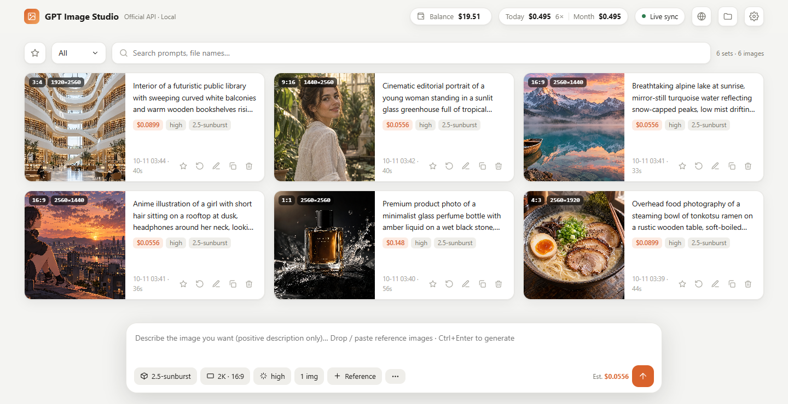
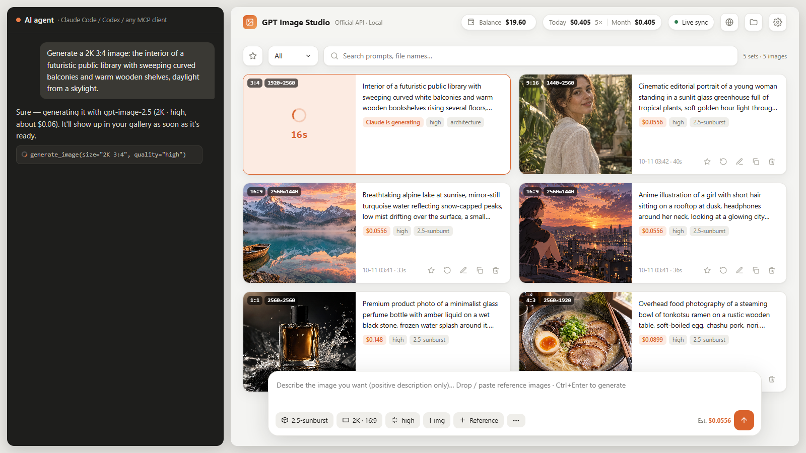

# GPT Image 工作台

[English](README.md) · **中文** · [日本語](README.ja.md) · [한국어](README.ko.md) · [Русский](README.ru.md)

**用你自己的 OpenAI API key 调用 `gpt-image-2.5` 的出图工作台。在 AI 智能体里说一句话就能出图，网页上实时看到图片、这张花了多少钱，以及还剩多少余额。**



*在智能体里说一句，网页上实时出现：*



## 它能做什么

- **在 AI 智能体里直接出图**：对 Claude Code、Codex 或别的能运行命令的智能体说「出一张 2K 16:9 的……」，它会调用官方接口出图、存到本地，并告诉你这张花了多少钱。
- **网页图库实时同步**：智能体出图时，网页上会出现「正在出图」的卡片和计时，出完自动换成结果。你也可以直接在网页上出图。
- **参数齐全**：gpt-image-2.5 的 sunburst / flare；1K / 2K / 4K 任意比例（最大 3840×2160）；质量从 low 到 **xhigh / max**；最多 16 张参考图；遮罩局部重绘。
- **算钱**：每张图按 OpenAI 实际返回的 token 用量计算花费，统计今天、本月和累计的花费；校准一次余额后，会自动显示还剩多少（OpenAI 没有查余额的接口，这是能做到最准的办法）。
- **图库**：收藏、按状态筛选（已完成 / 生成中 / 失败）、搜索、一键复用参数、把结果当参考图继续改。删除的图会移到 `.trash` 文件夹，不会直接抹掉。
- **哪里都能打开**：同一个网页可以放在 GitHub Pages 上。在运行着本机服务的电脑上打开，会自动连上本机服务；在别的设备上打开就是「浏览器模式」，key 和图都只存在那个浏览器里。
- **余额自动同步（官方 API）**：装一个小浏览器扩展，自动从 OpenAI 后台账单页读取真实余额同步过来，见 [extension/README.md](extension/README.md#中文)。
- **五种语言**：English、中文、日本語、한국어、Русский，默认跟随浏览器语言，也可以在网页上切换。
- **支持中转站**：兼容 one-api、new-api 等 OpenAI 中转，支持返回图片链接、按张计费、直接读取中转站的真实余额，见下面的[中转站](#中转站兼容-openai-的中转服务)一节。
- **零依赖**：只需要 Python 3.9 以上，不用 `pip install` 任何东西。

### 本地服装与姿势图库

**v0.5.0 新功能。** 第一次打开本地工作台时，页面会显示下载大小和 **「立即下载」「不下载」** 两个按钮。选项在屏幕上可见满 **20 秒** 后，工作台会自动从上游 GitHub 仓库下载缺少的图库。完整图库包含 **1,407 套服装、288 组姿势（1,439 张视角图）**，下载量约 **820 MB**，安装时建议预留 **1.7 GB** 空间。

- **暂时不需要**可以直接点「不下载」，工作台重启后也会记住。下载途中可以点「停止下载」，以后从「服装与姿势 → 立即下载」继续。遇到网络中断可点「重试」，已装好的图库会保留，尚未完成的那一套会重新下载。
- **保存位置**默认为用户主目录下的 `Pictures/gpt-image-libraries`。启动前设置环境变量 `GPT_IMAGE_LIBRARY_DIR` 可以换盘，设置 `GPT_IMAGE_AUTO_DOWNLOAD=0` 可以预先关闭自动下载。安装图库需要启动本地服务，单独打开 GitHub Pages 使用的是纯浏览器模式。
- **选图生图**时，在输入框下方点「服装与姿势」，按分类或编号选服装，或先选动作再切换视角。点「加入参考图」后可与自己上传的图片混用。参考图按添加顺序编号，提示词可以写“服装按图 1，姿势和机位按图 2”。浏览读取本机文件，点生成时才会把选定的原图发给你配置的生图 API。

**已有图库**可以直接接入。在本机服务使用的 `config.json` 旁创建 `reference-libraries.local.json`，填入已分类的目录。工作台优先使用这些目录，只自动安装尚未配置的图库。

```json
{
  "outfits": {"root": "D:/图库/服装"},
  "poses": {"root": "D:/图库/姿势"}
}
```

服装目录的结构是 `大类/子类/编号.webp`，姿势目录是 `体系/动作分类/姿势组/视角_编号.png`。每个库还可填写 `thumbnails`，指向目录结构相同的缩略图库（服装用 WebP，姿势用 JPG）。重新打开图库会读取目录中的变化。

**素材来源与使用范围。** 工作台从固定的上游版本下载并校验文件，在本机保留来源许可。工作台的 MIT 许可适用于工作台代码。服装来源对素材重新打包分发另有说明，姿势来源明确将图片及原始数据限定为**非商业用途**，并注明原作者为 @giaaibusi。[服装来源与素材条款](https://github.com/paipiange/nvzhuang/blob/f13741ebc09c73a63b92f626a115a1bb74ed779f/docs/LICENSE-DECISION.md) · [姿势来源与许可](https://github.com/paipiange/ai-pose-gallery-zh/blob/0596708b11fe7ce874ac519e4f2538c92918b07f/LICENSE)。

## 安装

### 作为 Claude Code 技能（推荐）

```bash
git clone https://github.com/konglingbukong/gpt-image-studio ~/.claude/skills/gpt-image
```

1. 运行 `start.bat`（Windows）或 `sh start.sh`（Mac / Linux），浏览器会打开 `http://127.0.0.1:8765`。
2. 在 设置 → API 配置 里填你的 OpenAI API key，点「测试连接」（不花钱）。
3. 在 Claude Code 里让它出图就行了。

key 也可以用环境变量 `OPENAI_API_KEY` 提供，或者写进 `config.json`（参考 `config.example.json`；这个文件不会被 git 提交）。

### 只用网页（不用安装）

打开 **https://konglingbukong.github.io/gpt-image-studio/**，在设置里填好 key 就能出图。这时用的是浏览器模式：key 和图片只存在你的浏览器里，浏览器直接请求 OpenAI，中间不经过任何第三方服务器。

### 其他智能体（Codex、Cursor、Gemini、Antigravity、WorkBuddy……）

按你的智能体支持哪种，选一种接法：

**① MCP（大多数智能体都支持）**：把 `scripts/mcp_server.py` 注册成 MCP 服务，智能体里就会多出 `generate_image`、`check_connection`、`get_spending` 三个工具。下面的 `<路径>` 换成你 clone 下来的文件夹：

- **Claude Code**：`claude mcp add gpt-image -- python <路径>/scripts/mcp_server.py`
- **Codex**（`~/.codex/config.toml`）：
  ```toml
  [mcp_servers.gpt-image]
  command = "python"
  args = ["<路径>/scripts/mcp_server.py"]
  ```
- **Cursor / Gemini CLI / 其他用 JSON 配置的客户端**（`mcpServers` 字段）：
  ```json
  { "mcpServers": { "gpt-image": { "command": "python", "args": ["<路径>/scripts/mcp_server.py"] } } }
  ```

**② 技能文件夹**：支持 `SKILL.md` 格式的智能体（Codex、WorkBuddy 等），把整个文件夹放进它们的技能目录就行。

**③ 说明文件**：其他能运行命令的智能体，让它读 [AGENTS.md](AGENTS.md) 照着做。

不管用哪种接法，出的图都存进同一个文件夹，并实时出现在网页工作台上。

**已验证可用**：Claude Code、Codex（含 ChatGPT 桌面版）、WorkBuddy、Antigravity、DeepSeek Harness（dsh）。完整列表、各家的配置写法、接口格式和新智能体的接入步骤，见 **[docs/INTEGRATIONS.md](docs/INTEGRATIONS.md)**。你用的智能体还没支持的话，欢迎到 Issues 提「适配申请」，或者参照 [CONTRIBUTING.md](CONTRIBUTING.md) 自己接好后提交 PR。

## 中转站（兼容 OpenAI 的中转服务）

很多人不是直连 OpenAI，而是通过中转站（one-api、new-api 这类）来用 gpt-image，这些也都能用：

- **怎么填**：设置 → API 配置 里，API URL 填中转站的地址（一般以 `/v1` 结尾），API Key 填中转站给的 key。中转站的模型名不一样（比如叫 `gpt-image-2.5`）的话，在模型菜单里直接输入它的名字。
- **返回图片链接**：有的中转站返回的是图片链接而不是图片数据，程序会自动下载保存，跟官方一样。
- **严格的中转站**：如果中转站不认官方才有的参数（`moderation`、`output_format`、`background`），打开「**只发送基础参数**」就行。遇到这种报错时，提示里也会告诉你这么做。
- **按张计费**：中转站大多按张收费。在「计费 → 按张计费」里填上单价，花费就按张算，不再按 token 算。
- **真实余额**：中转站支持 one-api / new-api 的账单接口的话，会自动读取中转站的真实余额，不用手动校准。
- **测试连接**：只支持 `GET /models` 的中转站也能正常测试。

命令行对应的 `config.json` 字段：`"api_url"`、`"api_key"`、`"model"`、`"minimal_params": true`、`"rates": {"per_image": 0.04}`、`"balance_source": "auto" | "relay" | "manual"`。

## 命令行用法

```bash
python scripts/gen.py --prompt-file prompt.txt --size "2K 16:9" --quality high --name 封面
python scripts/gen.py --prompt "一只橘猫" --size 1024x1024 --quality low
python scripts/gen.py --prompt-file p.txt --ref face.png --ref outfit.png --size "4K 9:16"
python scripts/gen.py --check          # 只测 key 和网络，不花钱
python scripts/gen.py ... --json       # 只输出一行 JSON，给脚本和适配程序用
```

完整参数见 [SKILL.md](SKILL.md)。命令行提示默认是英文，在 `config.json` 里写 `"lang": "zh"` 就改成中文。

## 个性化

在技能文件夹里新建 `rules.local.md`，写上你自己的偏好（默认规格、写提示词的习惯等），智能体出图前会先读它。这个文件不会被 git 提交。

## 安全说明

- 本机服务只监听 `127.0.0.1`，并且检查 `Host` 和 `Origin`，只接受本机页面和 `config.json` 里 `allowed_origins` 列出的网站发来的请求，别的网页没法拿它来花你的钱。
- key 只会发给你设置的 API 地址（默认是 OpenAI 官方）。

## 费用说明

花费按 `config.json` 里的 `rates`（美元 / 百万 token）计算，默认值是写作时 gpt-image-2.5 的价格：文字输入 5、图片输入 8、图片输出 30。**OpenAI 调价后请到 设置 → 计费 里修改。** 显示的余额是估算值，以 OpenAI 后台为准。

## 致谢

界面布局参考了 [CookSleep/gpt_image_playground](https://github.com/CookSleep/gpt_image_playground)（MIT），代码是独立编写的。

## 许可

工作台代码采用 [MIT](LICENSE) 许可。下载的参考图遵循各自的[上游素材条款](#本地服装与姿势图库)。
